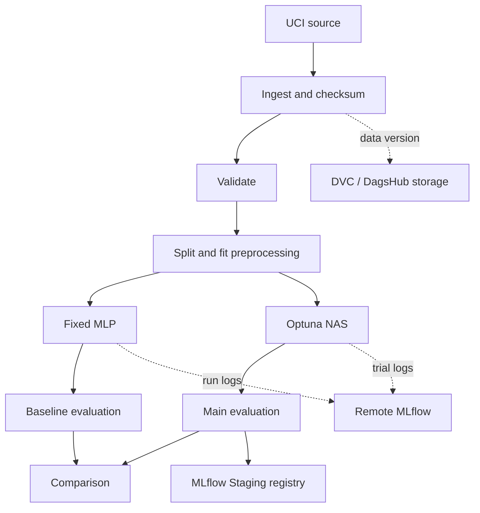

# ModelForge architecture

The repository separates the reusable ML core from platform interfaces and generated artifacts.

## Implemented for Deliverable 1

| Location | Responsibility |
| --- | --- |
| `src/modelforge/data/` | Source ingestion, checksum verification, validation, and preprocessing. |
| `src/modelforge/models/` | PyTorch MLP blocks, checkpoint loading, and raw-feature MLflow inference. |
| `src/modelforge/training/` | Fixed baseline training and sequential Optuna NAS. |
| `src/modelforge/evaluation/` | Held-out metrics, latency/size measurement, comparison, and evaluation artifacts. |
| `src/modelforge/tracking/` | Remote model registration and hosted prediction verification. |
| `src/modelforge/utils/` | Configuration, JSON output, deterministic execution, and tracking authentication. |
| `src/modelforge/pipeline.py` | Thin CLI entry point used by DVC. |
| `params.yaml` | Versioned data, split, model, search, and tracking parameters. |
| `configs/report.yaml` | Report metadata and the supplied team roster. |
| `scripts/evidence/` | Capture actual remote MLflow screens and the real DVC dependency graph. |
| `scripts/reports/` | Generate the submission PDF from real results and evidence. |
| `reports/data/` | Validation and split summaries. |
| `reports/metrics/` | Baseline/main metrics and their comparison. |
| `reports/classification/` | Per-class evaluation reports. |
| `reports/figures/` | Confusion matrices. |
| `reports/tracking/` | Registry version and Staging verification. |
| `reports/verification/` | Reproduction evidence when requested. |
| `submission/deliverable_1/` | Final PDF and accompanying write-up. |

## Reserved for the complete platform

`services/api/` will expose dataset submission, training-job management, model selection, and prediction. It will call the ML modules rather than duplicate training logic. Long-running jobs should execute outside request handlers, with one training job at a time.

`apps/dashboard/` will provide dataset upload, job progress, model comparison, and deployment status. It will consume API responses; it will not load training code in the browser.

`infra/aws/` will contain the later EC2, Docker Compose, environment, and deployment setup. Controlled model promotion, drift monitoring, and retraining are later work. These directories currently document boundaries; they do not claim to provide working services or cloud deployment.

The original proposal and assignment remain in `docs/`. Setup instructions are in `docs/setup/`, and milestone requirements are in `docs/deliverables/`.
